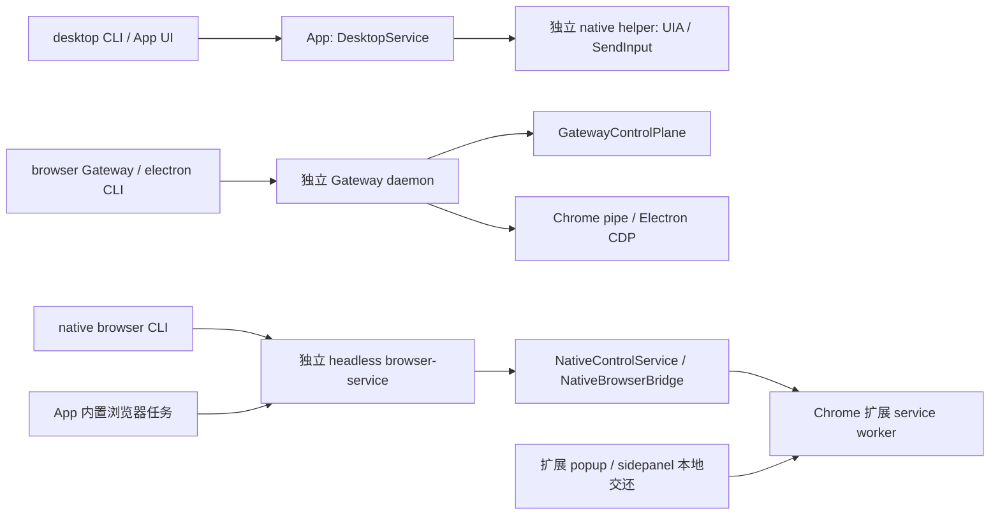

# Desktop、Gateway 与原生浏览器的共同控制 reservation

状态：**设计评审，未实现。** 本文不是已交付的排他保证。现有桌面准入仍是新鲜采样与派发前复查，不能消除另一个入口在最后一次采样后取得控制权的竞态。

评审日期：2026-10-30（北京时间）。本轮只读取源码和已有纯模拟反例，没有启动 GUI、操作系统扫描、输入 hook 或 daemon，没有进行真实输入测试。

## 已证实的反例及证据边界

本机产物 `.tools/desktop-verification/admission-race-audit.json` 及同目录 `admission-race-audit.cjs` 组合了真实的 `DesktopService`、`evaluateDesktopAdmission` 和 `BrowserGatewayControlPlane`。这些本机产物不保证随源码分发；关键顺序记录如下：

1. desktop 对 PID 41 的准入计算得到 `available`，在返回结果前暂缓。
2. Gateway 为 `browser-racer` 成功 `acquire` 并消费 ticket。
3. desktop 得到先前的结果并派发 action；此时 Gateway 的 `assertConnectionCanSend` 也通过。
4. 下一次 desktop observation 才发现 `occupied` 并暂停。
5. Gateway 结束旧 session 后仍能再次 acquire，而 desktop 的用户暂停 session 仍存在。

报告明确记录 `realInput: false`、`guiStarted: false`、`networkStarted: false`，进程发现、observer ACK 与 native driver 均为 fake。它证明生产授权类之间的授权重叠，**不证明真实 OS 输入同时发生**。后续采样能发现冲突，不能撤销已派发的那次动作。

同轮共享 OS sample 可以减少重复扫描并保持原始采样时间，不能使采样与另一入口的授权变更成为原子事务。不能把性能优化或本地串行队列当作本设计已经实现。

## 当前入口、进程和权威

| 路径 | 当前权威 | 共同仲裁缺口 |
| --- | --- | --- |
| desktop | App 内存 owner、revision、observer generation；helper 校验窗口身份 | admission 是采样；没有跨进程 reservation |
| Gateway/browser/electron | daemon 的 `GatewayControlPlane`、ticket、controlGeneration | 只约束 Gateway 自己的 session |
| native browser | browser-service session map，加扩展 session/epoch | 不读取 desktop/Gateway reservation |
| 扩展本地交还 | 扩展直接恢复 agent 并 attach | 不经过 browser-service 的 claim 入口 |

重要边界：

- [DesktopService](../src/main/desktop/service.ts) 的 `checkAdmission` 与 `window.action` 派发分开；claim、resume、select 各有本地代次检查，但其他进程不知道这个 owner。
- [GatewayControlPlane](../src/main/browser-gateway-control.ts) 的 `acquire`、`returnToAgent` 和 `assertConnectionCanSend` 不查询 desktop/native owner。`internal` 连接身份在发送检查中直接通过；不能把所有 internal 操作认定为只读。
- [Gateway server](../src/main/browser-gateway-server.ts) 还有 raw CDP、设备模拟、可信 handoff reveal、internal attach 等实际控制路径，必须纳入派发边界。
- [browser-service host](../src/main/browser-service/host.ts) 区分 App 的 `pp-task-*` 和独立 CLI session。App 断开只暂停对应 App session，不结束独立 CLI。
- [NativeBrowserBridge](../src/main/tasks/native-bridge.ts) 是 App 和直接 CLI 的共同扩展请求入口；断线会移除 connection state，缺少连接不能推导为没有遗留 owner。
- [扩展 background.js](../extensions/profilepilot/background.js) 的本地 `return` 可恢复 agent，调试器恢复可重新 attach，worker 重启可恢复暂停 session。这些都必须参与新协议。

## 有限范围的目标保证

第一版可限定为 Windows 上参与新版协议的 ProfilePilot 入口，对同一个已确认进程控制域提供：

> 任一时刻，同一控制域只有一个 reservation owner 能获得新的控制操作派发许可；暂停保留占用；结束未确认不释放；旧代次 ACK 或重连不能恢复授权。

控制相关操作包含 UIA、SendInput、CDP 输入、导航、调试 attach、窗口激活等，不能只保护鼠标键盘。真正不改变控制关系的读取可单独设计，不应凭 `Runtime.evaluate` 之类的方法名推断只读。

不包含任意第三方 raw CDP 客户端、其他自动化工具、物理硬件输入、已经触发的页面异步逻辑，也不提供不同应用之间所有前台焦点变化的原子性。旧版不参与协议的运行中服务不能被声明为已受约束；升级启用需要明确能力协商及旧实例处理。

## 共同权威与进程身份

建议在**现有 Gateway daemon** 中托管共同 authority，不新增另一种后台服务。但 authority 的发现和独占必须固定到同机用户/会话，不能随 Gateway home、`CPM_DATA_DIR` 或 native root 改变。

当前 [Gateway socket](../src/main/browser-gateway-client.ts) 按 home 生成，browser-service 按 root 唯一；不同目录可以产生互不知情的实例。共同 authority 需要经过验证的唯一启动/恢复协议。现有 PID 文件和按目录的 daemon lock 不能直接证明跨目录唯一。

| 来源 | 已有证据 | 缺少的共同证据 |
| --- | --- | --- |
| desktop helper | `Target` 内有 PID 与 `Process.StartTime.ToUniversalTime().Ticks`；window ID 含其 hash | TS/authority 可验证的创建身份；不能以窗口 hash 替代共同资源键 |
| managed Chrome | Gateway 保存 `transport.child.pid` | 同格式的 OS 创建身份 |
| Electron | `SystemInfo.getProcessInfo` 的 browser PID | OS 创建身份及每次重新 attach 的验证 |
| native extension | profileId、session、controlGeneration | 没有 OS PID；需要严格 profile→进程身份关联 |

参考：[native 目标身份](../native/desktop/windows.cs)、[DesktopWindow](../src/shared/desktop.ts)、[Electron transport](../src/main/electron-cdp-transport.ts)、[Windows 扫描](../src/main/windows-platform.ts)。

建议由可信 OS 查询统一返回无精度损失的创建时间字符串，并包含 PID、机器启动/会话范围。CIM `startedAt` 经 JavaScript 日期转换，不能直接假定与 .NET ticks 精确一致。controller PID、目标 PID 和 executor PID 是不同身份，均不能用 session 名代替。

同一 Chrome 根进程承载多个 Profile 时保守归入同一域。窗口 PID 与根进程的关联、监听端口归属或 profile 文件关联不完整时仍为 unknown；不能凭 exe 名推 Default。新子进程、PID 复用、浏览器重启和 backend 替换必须重新核对控制域。

## 最小协议和状态

这应是持有至明确结束的 reservation，**不是 TTL 到期即可抢占的短租约**。

| 操作 | 必须保证的语义 |
| --- | --- |
| reserve | 原子申请完整资源集合；持久化 pending 后才允许 claim 的准备动作，包括创建任务 tab |
| activate / resume | 绑定 reservation ID、controller instance、资源创建身份、authority epoch、participant generation；迟到 ACK 不得恢复已暂停 owner |
| beginAction / finishAction | 记录已获许可但未确认结束的派发；实际执行点核对 fence；超时保留 unknown，不自动重放 |
| pause | 本地同步阻止新动作并取消当前操作，再通知 authority；保留 reservation |
| beginRelease / finishRelease | 先撤销新派发，确认队列、transport/helper 停止，再释放；失败保留 ending/orphan |
| reconcile | 依据匹配的进程身份、executor 停止证据和 endpoint 状态恢复；断线、空列表、TTL 不是释放证据 |

协议变更需有幂等 request ID 和可查询回执；幂等管理请求不能变成自动重放业务输入。持久化失败或回复丢失必须保留可查询的 unknown，不能假定 reserve/release 未发生。

desktop `select` 原子申请新域并保留旧域，直到旧 helper 停止确认；失败保留旧 owner。driver 轮换保留 reservation。相同 session 字符串不能跨入口自动继承权限；若未来支持跨入口交接，需要显式原子 transfer。

## 必须一起改变的执行边界

- Gateway：`acquire`、return、ticket、实际 backend 派发共同校验。internal、raw CDP、设备模拟、恢复及清理路径必须逐项分类，不能全体豁免。
- browser-service：同时覆盖 direct CLI 和 App `pp-task-*`，不能只修改 `NativeControlService` 而遗漏 bridge request。
- 扩展：claim、resume、本地 return、调试器恢复和控制相关 attach 校验新 capability/fence。缺能力明确要求更新，不能默认参与。扩展本地交还需要向权威申请，不能只本地置 agent。
- desktop：包括 UIA 的所有 `window.action` 持有许可；observer 接管仍同步暂停。stop/expire/close 的 UI 状态与 reservation 释放确认分开表达。
- 身份替换：Gateway register/unregister、Electron reattach、浏览器重启不得直接把旧 owner 移到新 PID 或立即清除未知占用。

现有 [DesktopWorker.stopConfirmed](../src/main/desktop/worker.ts) 可作为停止证据的一部分，但需把 executor 创建身份和回执跨进程传递。App 死亡不能单独证明仍存活 helper 已停止输入。

[NativeControlService](../src/main/native-control/service.ts) 的 direct complete/release 断线时保留 ending，可复用其原则。相反，[NativeBrowser.control](../src/main/tasks/native-browser.ts) 在断线且非 resume 时直接返回的兼容行为，不能当共同 authority 的 release ACK。服务重启丢失内存 session 后，需要 orphan reconciliation，不能仅要求新 claim。

## 暂停、退出与恢复

| 事件 | reservation 行为 |
| --- | --- |
| 用户接管、会话暂停 | paused，保留占用，显式 resume 才重新取得动作权限 |
| App 退出 | 独立 native CLI session 不受影响；desktop 等 helper 停止证明 |
| browser-service 或扩展断线 | orphan/unknown；空 states 不能释放 |
| helper close 未确认 | ending；匹配创建身份的 helper 确认退出后才能完成 |
| authority 不可用 | 各 participant 停止新授权并本地暂停；不能自动启动旁路 authority |
| authority 重启 | 新 epoch；旧记录先恢复为阻塞状态，不能自动恢复 agent |
| journal 损坏、未知版本 | unavailable；不能容错成空占用表 |
| TTL 或心跳超时 | 撤销动作权限，保留未确认占用 |

现有桌面五分钟 expire 会进入 `end()`，先清本地 owner 再异步关闭 driver。共同 reservation 不能照搬该释放时机。现有 Gateway 容错加载坏 state 后返回空表，也不能直接用作 authority journal 恢复逻辑。

宏观保证是授权派发排他。对于已经交给浏览器、native provider 或页面的操作，应明确其结束回执范围；无法确认的 in-flight 操作不能用超时“排空”。页面后续自主行为不属于能够撤销的派发。

## Windows 与 macOS

Windows 可先实现身份适配和完整入口门禁。macOS 当前 `ps` 启动时间不能直接当同等精度的创建身份，需要单独实现和验收进程身份适配。

若先限制 Windows，产品能力及报告应明确此范围；macOS 继续已有行为及兼容测试，不能宣称共同 reservation 已在 macOS 生效。平台不支持也不能返回伪造的创建身份。

## 阶段验收和发布条件

1. **协议与真实类纯反例**：改造现有 audit 成稳定回归；覆盖双向 acquire、paused 保留、迟到 ACK、release 未确认、PID 复用、扩展本地 return、internal 写入、不同 root。使用 fake OS/observer/driver，不把模型通过称作实机通过。
2. **身份和能力链路**：贯通 desktop/Gateway/native 的同格式进程身份；同 PID 不同创建身份、同 Chrome 根的多 Profile、无法关联 native Profile、旧扩展、不同 authority 等反例必须拒绝。
3. **全部入口门禁**：共同持久权威、派发 fence、排空回执和恢复路径同时接入。任何生产入口仍可独立授权时，不得宣称 audit 已解决。
4. **跨进程故障测试**：注入 reserve/activate/release ACK 丢失、authority 重启、App/daemon/browser-service/helper 退出、扩展断线与 worker 重启；验证新 owner 在未知结束时始终被拒绝，旧 ACK 永不复活。
5. **受控实机矩阵**：按独占 GUI 调度，在自有 fixture 上分别验证 Gateway、native、desktop 双向竞争、用户接管和恢复；记录 PID/创建身份、实际 build、是否真实输入、停止证明及清理结果。

剩余数小时可以交付可审查的协议、纯反例和身份链路阶段，但不能据此承诺扩展更新、全部执行入口及跨进程崩溃矩阵已验证完成。没有完整通过这些阶段之前，保留当前新鲜准入与 fail-closed 行为，并继续明确其采样竞态限制；不要临时加入局部锁后宣传全入口排他。
